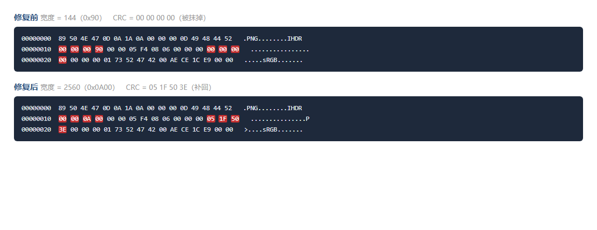

# [Misc] 被揉坏的芙芙

| 项目 | 内容 |
|---|---|
| **比赛** | ?CTF 2026 |
| **方向** | Misc |
| **题目名** | 被揉坏的芙芙 |
| **分值 / 难度** | 200 / 简单 |
| **解题日期** | 2026.10.08 |
| **耗时** | 约 90 分钟（其中一半是 010 Editor 手滑重来） |
| **最终 flag** | `?CTF{CrC32_15_1mp0r74n7}` |

---

## 一、题目给了什么

- **附件**：`fufu.zip`（1,714,406 字节），解开后里面是一个 `芙.png`（1,713,906 字节）
- **题目描述**：

  > 我的芙芙图片被人挤坏了。。还挤出来了一串神秘字符 `051F503E`，这是做什么的哇?

- **提示**：`flag 格式应为 ?CTF{xxx}`

**一眼能记住的两个数**：附件里那串 `051F503E` 正好是 8 位十六进制 = 4 个字节。
"被人挤坏了" = 文件被人动过手脚。这两句话后面都用上了。

---

## 二、我的第一反应
我看到题目猜到他应该是一个图片的部分字节是错误的需要修改
## 三、分析过程

### 第 1 步：认文件

先看这个 zip 里到底是什么东西。

```bash
7z l fufu.zip
7z x fufu.zip -o extracted
```

解出来一个 `芙.png`。压缩包本身是干净的（没加密、没改过），所以问题**只可能在图片里面**。

### 第 2 步：看开头 16 个字节

```bash
xxd 芙.png | head -4
```

（Windows 上等价的是 PowerShell 的 `Format-Hex 芙.png`）

```
00000000   89 50 4E 47 0D 0A 1A 0A 00 00 00 0D 49 48 44 52   .PNG........IHDR
00000010   00 00 00 90 00 00 05 F4 08 06 00 00 00 00 00 00   ................
00000020   00 00 01 73 73 52 47 42 00 AE CE 01 ...              ...sRGB....
```

**读法**：最左边是偏移（第几个字节，十六进制），中间 16 个十六进制数就是字节本身，右边是同一批字节按文本显示的样子。

逐段翻译：

| 偏移 | 字节 | 含义 |
|---|---|---|
| `0x00` | `89 50 4E 47 0D 0A 1A 0A` | PNG 的签名（身份证） |
| `0x08` | `00 00 00 0D` | IHDR 这个块的**长度** = 13 |
| `0x0C` | `49 48 44 52` | 块的**名字** = "IHDR"（图像头） |
| `0x10` | `00 00 00 90` | 宽度 = **144** |
| `0x14` | `00 00 05 F4` | 高度 = **1524** |
| `0x18` | `08` | 每通道 8 位 |
| `0x19` | `06` | 颜色类型 6 = RGBA（带透明度） |
| `0x1A` | `00` | 压缩方式（固定 0） |
| `0x1B` | `00` | 滤波方式（固定 0） |
| `0x1C` | `00` | 是否隔行（0 = 不隔行） |
| `0x1D` | `00 00 00 00` | **这个块的 CRC 校验码 —— 四个零，很可疑** |

### 第 3 步：把整张 PNG 的所有块走一遍，验 CRC

写了个 `png_chunks.py`，从头到尾走一遍每一块，逐块重算 CRC 和文件里存的对比。

输出里**只有一块不对**：

```
#00  IHDR   stored=0x00000000   calc=0x261B8053   ** CRC MISMATCH **
#01  sRGB   stored=0x00AECE01   calc=0x00AECE01   OK
#02  gAMA   ...
...（一直 OK 到 #34）
```

**只有 IHDR 一块不对，而且别的块全都对。** 这说明不是文件损坏 —— 损坏不会挑得这么准。

### 第 4 步：为什么说它是"被擦掉"而不是"算错了"

存进去的值是**整整四个零**。

一个 CRC 自然算出来正好等于 `0x00000000` 的概率是 2 的负 32 次方，大约是 **43 亿分之一**。

这不是巧合，是**有人手动把那一行的 4 个字节全抹成了 0**。

### 第 5 步：题目描述替我们把答案说了一半

题目里说"挤出来了一串神秘字符 `051F503E`"。

`051F503E` 正好 8 位十六进制 = 4 个字节 = **正好是一个 CRC 的长度**。

**那不是"挤出来的神秘字符"，那是被抹掉之前，IHDR 真正的 CRC 值。**

### 第 6 步：数据量对不上（最硬的一条证据）

宽度要是真的只有 144，那整张图的数据量应该是：

```
每行字节数 = 宽度 × 4（RGBA 每像素 4 字节）+ 1（每行开头一个滤波标志字节）
          = 144 × 4 + 1 = 577
总长度     = 577 × 1524 = 879,348 字节
```

但把 IDAT 块（真正的像素数据）用 zlib 解开，**实测是 15,607,284 字节**。

`15,607,284 ÷ 879,348 ≈ 17.7 倍`。

**差了 17 倍多。** 说明标签上写的宽度**小报了**，真实宽度要大得多。

### 第 7 步：反着用 CRC 把宽度算出来

CRC 是从块的内容算出来的。既然我们知道"正确的 CRC 是 `0x051F503E`"，就可以**把算式反过来用**：

> 把所有可能的宽度、高度代进去，算 `CRC32("IHDR" + 宽度 + 高度 + 08 06 00 00 00)`，
> 看哪一组正好等于 `0x051F503E`。

跑 `brute_ihdr.py 12000 12000`（搜 1.44 亿组），**17.3 秒，只有一组命中**：

```
** FOUND **  width=2560  height=1524
```

**高度 1524 从头到尾都是对的，只有宽度被人从 2560 改成了 144。**

### 第 8 步：用两条互不相干的路验证

```
compressed IDAT bytes  : 1713020
decompressed raw bytes : 15607284

candidate   144 x 1524  -> expected raw =   879348      no match
candidate  2560 x 1524  -> expected raw = 15607284      MATCH
```

第 7 步走的是**数学**（反推 CRC），第 8 步走的是**物理**（数一数像素数据到底有多长）。

**两条路完全不相干，却指向同一个数 —— 到这一步才敢下结论。**

### 第 9 步：用 010 Editor 把两个字段改回去

要改两处：

| 偏移 | 现在 | 改成 |
|---|---|---|
| `0x10` | `00 00 00 90`（144） | `00 00 0A 00`（2560） |
| `0x1D` | `00 00 00 00` | `05 1F 50 3E` |

改完另存为 `芙_已修复.png`。

**验证**：用系统自带的图片库把它解开，读出 **2560 × 1524**，和爆破出来的完全一致。图片终于是正常的了。

---

## 四、卡住的地方
010 Editor 里两次把文件改坏（第一次少了 1 个字节，第二次把开头的 `89` 删掉了）、
没把文件格式改为.png。


---

## 五、关键截图



**说明**：左边是题目原图的前 48 个字节，红色标出两个被动手脚的地方 ——
偏移 `0x10` 的宽度写着 `00 00 00 90`（144），偏移 `0x1D` 的 CRC 被抹成 `00 00 00 00`。
右边是修好之后，同样的两个位置变成了 `00 00 0A 00`（2560）和 `05 1F 50 3E`。
**除了这 8 个字节，前后完全一样** —— 这就是这题的全部机关。

---

## 六、最终解法（给别人的版本）

**核心原理**

PNG 文件的结构是「块」套「块」。开头那个 IHDR 块里写着**这张图有多宽、有多高、什么格式**，
而它**后面**跟着的是一大段平铺直叙的像素数据 —— 里面**没有任何分隔符**。

所以软件读图时的逻辑是：**按 IHDR 里写的宽度，每读够这么多个像素就折一次行。**

里面写 144，它每 144 个像素就折行；可真实的一行有 2560 个像素。折错位置，整张图就全乱了。

出题人干了三件事：

1. 把 IHDR 里的宽度从 2560 改成 144
2. 改完 CRC 就对不上了，于是**把 CRC 那 4 个字节抹成 0**
3. 把真正的 CRC 值 `051F503E` 写进题目描述里当"神秘字符"

所以我们只要把宽度改回去、把 CRC 补回去，图就回来了。

**完整步骤**

1. `7z x fufu.zip -o extracted` 解出 `芙.png`
2. `Format-Hex 芙.png`（或 `xxd`）看开头，认出 PNG 签名 + IHDR
3. 用 `png_chunks.py` 走一遍所有块，发现**只有 IHDR 的 CRC 不对**且被抹成 0
4. 注意到题目给的 `051F503E` 正好是 4 字节 = CRC 长度 → 那就是原始 CRC
5. 用 `verify_dims.py` 量出 IDAT 解压后有 15,607,284 字节，和 144×1524 对不上
6. 用 `brute_ihdr.py` 反推 CRC，唯一命中 **2560 × 1524**
7. 010 Editor：`Ctrl+G` 输 `10` → **单击**那个字节 → 一口气打 `00000A00`；
   再 `Ctrl+G` 输 `1D` → 打 `051F503E` → 另存
8. 打开改好的图，flag 就在图上

**关键命令 / 代码**

```bash
# 认文件
7z l fufu.zip
7z x fufu.zip -o extracted

# 看字节（Linux/WSL）
xxd 芙.png | head -4
# 看字节（Windows PowerShell，会自带列号，对新手更友好）
Format-Hex 芙.png

# 逐块验 CRC
python png_chunks.py 芙.png

# 量像素数据长度
python verify_dims.py

# 反推宽度高度
python brute_ihdr.py 12000 12000
```

---

## 七、学到了什么

| 学到的东西 | 以后能用在 |
|---|---|
| PNG 的 IHDR 写着宽高，后面的像素流没有分隔符，宽高错了整张图就乱 | 所有"图片打不开 / 显示错乱"的 Misc 题 |
| CRC32 是分块内容的校验码，**可以反过来用**推算被改掉的字段 | 任何"字段被改坏、但校验值还留着"的场景 |
| 「差 17 倍」这种数量级上的对不上，比任何猜测都硬 | 一切需要判断"这个数字合理吗"的地方 |
| 两条互不相干的证据（数学反推 + 物理长度）指向同一个数，才敢下结论 | 以后做判断的通用习惯 |
| 010 Editor：`Ctrl+G` 跳转 → **单击**定位 → **直接打十六进制就是覆盖，不是插入** | 所有需要改字节的题 |
| 改二进制：**长度一个字节都不能变**，改完先看左下角 `Size:` | 同上 |

**涉及的知识点**

- [x] 新工具：**010 Editor**（十六进制编辑器）、**Detect It Easy / DIE**（识别文件类型与编译器）
- [x] 新命令：`xxd` / `Format-Hex`（看字节）、`png_chunks.py`（走 PNG 块结构）
- [x] 新概念：**PNG 块结构**、**CRC32 校验**、**变长字段可以被反推**

**CSAPP / 课程对应**

- **CSAPP §2.1 信息的存储** —— 十六进制、一个字节 8 位、大文件用小端存多字节整数
- **CSAPP §2.1.4 字节序** —— `00 00 0A 00` 这 4 个字节按大端读出 2560（网络序，PNG 用的就是大端）
- **CSAPP §3.8 数组的分配与访问** —— "总长度 = 行数 × 每行字节数"，第 6 步那个乘法就是它

---

## 八、一句话总结

再面对图片损坏题目时，应该先解压图片根据字节数量分析长宽，再细读题目里给的条件，修改错误的字节。

*本题用到的脚本都在 `D:\DSH\csapp\ctf-writeups\工具\` 下，换个文件还能用。*
